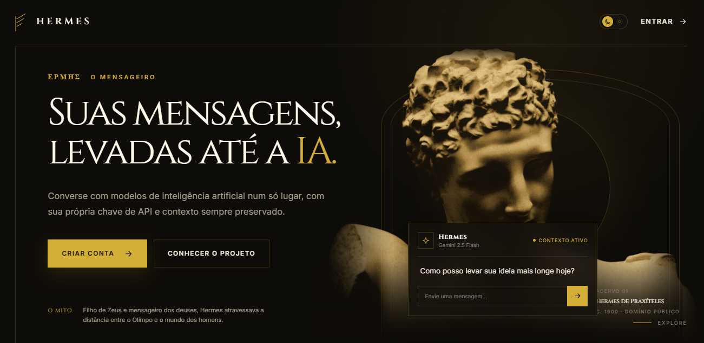
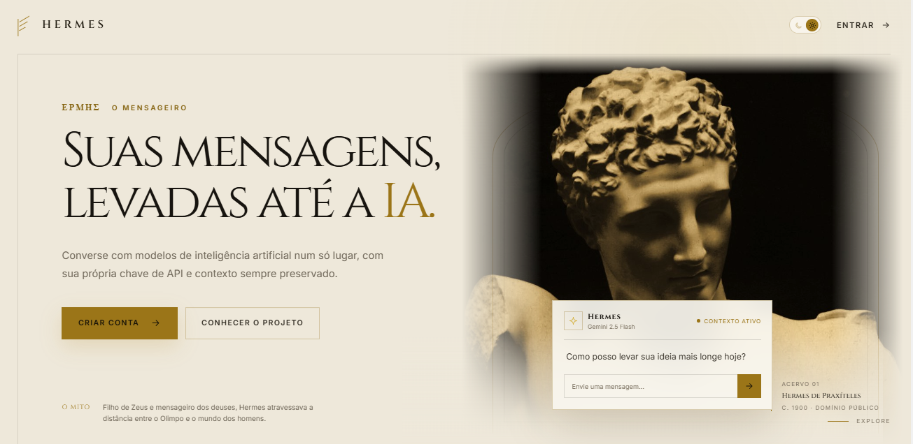
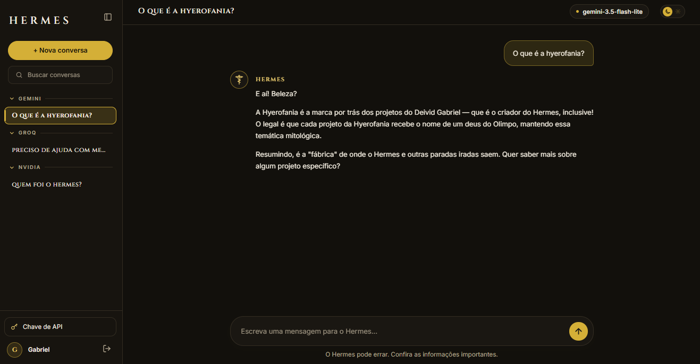
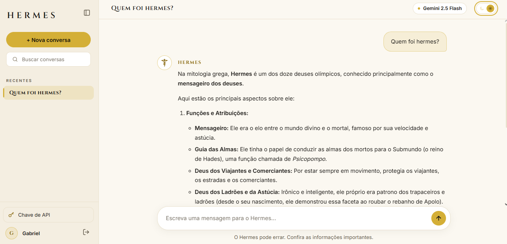
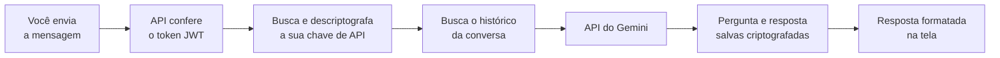

<p align="center">
  
</p>

<h1 align="center">HERMES</h1>

<p align="center">
  <strong>Um mensageiro entre você e a inteligência artificial.</strong><br>
  Converse com a IA num só lugar, com a sua própria chave de API e com as suas conversas guardadas com segurança.
</p>

<p align="center">
  
  
  
  
  
  
  
  
</p>

<p align="center">
  <a href="https://hermes-b1r.pages.dev"><strong>Abrir o Hermes</strong></a>
  ·
  <a href="#rodando-localmente">Rodar localmente</a>
  ·
  <a href="#roadmap">Roadmap</a>
</p>

> A API está no plano gratuito do Render e "dorme" quando fica parada. Na primeira vez, o login pode levar cerca de 50 segundos.

---

## Telas

<table>
  <tr>
    <td align="center"><br><sub>Página inicial · tema escuro</sub></td>
    <td align="center"><br><sub>Página inicial · tema claro</sub></td>
  </tr>
  <tr>
    <td align="center"><br><sub>Chat · tema escuro</sub></td>
    <td align="center"><br><sub>Chat · tema claro</sub></td>
  </tr>
</table>

---

## Por que o Hermes existe

Hoje, quem usa IA no dia a dia vive pulando de site em site: uma pergunta no ChatGPT, outra no Gemini, outra no Claude ou no Grok. Cada conversa fica presa no site onde começou, e uma IA nunca sabe o que a outra respondeu.

O Hermes nasceu da ideia de **juntar tudo num lugar só**. O nome vem de Hermes, o mensageiro dos deuses gregos, que levava recados entre o Olimpo e o mundo dos homens. Aqui, o Hermes leva as suas mensagens até as IAs e guarda as conversas para você.

O objetivo final vai além de um chat:

- **Todas as conversas num ponto só**, sem precisar sair de um site para entrar em outro.
- **Várias IAs ao mesmo tempo:** mandar uma mensagem para o Grok e, enquanto ele responde, mandar outra para o ChatGPT.
- **IAs conversando entre si** para chegar a uma resposta melhor, como um consenso entre elas.
- **Várias IAs no mesmo projeto:** colocar ChatGPT, Claude, Gemini e Grok para analisar um projeto juntos, cada um achando falhas e ideias diferentes, ou trabalhando juntos numa mesma tarefa.

A **versão 1.0** é a base de tudo isso: contas de usuário, chat com o Gemini, histórico de conversas e uma estrutura segura para guardar chaves e mensagens. Os próximos estágios estão no [Roadmap](#roadmap).

## Para quem é

- **Quem usa várias IAs** e quer as conversas organizadas num lugar só.
- **Quem já tem a própria chave de API** e quer usar a IA sem depender do site oficial.
- **Quem se preocupa com privacidade:** as chaves e as conversas ficam criptografadas no banco.

---

## Funcionalidades

### 🔐 Conta

- Cadastro com **verificação de e-mail por código**
- Login com e-mail e senha
- **Recuperação de senha** com código enviado ao e-mail (válido por 15 minutos)
- Sessão protegida por **token JWT**

### 💬 Chat

- Conversa com a IA (Gemini) que **mantém o contexto**: as mensagens anteriores vão junto com cada pergunta
- Respostas com **Markdown**: títulos, negrito, listas e blocos de código com destaque de sintaxe
- Envio com **Enter** e quebra de linha com **Shift + Enter**

### 🗂️ Histórico

- Todas as conversas salvas e listadas na barra lateral, das mais recentes para as mais antigas
- Abrir uma conversa antiga e continuar de onde parou
- Botão de **nova conversa** e **busca** pelo título
- Barra lateral que pode ser escondida, e que vira gaveta no celular

### 🔑 Chave de API

- Cada usuário cadastra a **própria chave do Gemini** (gratuita no Google AI Studio)
- A chave é **criptografada** antes de ir para o banco, e a tela mostra só os últimos 4 caracteres

### 🎨 Interface

- Identidade visual inspirada na Grécia Antiga: dourado, mármore e a estátua de Hermes
- Tema **escuro** (padrão) e **claro**
- Layout responsivo para computador e celular

---

## Como funciona uma mensagem



## Segurança

| O quê | Como é protegido |
|---|---|
| Senha do usuário | Guardada apenas como **hash**; a senha original não pode ser recuperada |
| Chave de API do usuário | **Criptografada com AES-256-GCM** antes de ir para o banco; só a API descriptografa, na hora de usar |
| Mensagens e títulos das conversas | **Criptografados com AES-256-GCM** no banco; descriptografados só na API |
| Identidade nas requisições | **Token JWT** assinado pela API: as rotas do chat sabem quem é o usuário pelo token, e não por um e-mail enviado pelo navegador |
| Acesso às conversas | Ao abrir uma conversa ou mandar mensagem nela, a API confere se ela pertence ao usuário do token |
| Códigos de verificação | Guardados como hash, com validade de 15 minutos e ligados à conta |
| Segredos (banco, chaves, e-mail) | Fora do código: User Secrets no desenvolvimento e variáveis de ambiente em produção |
| Origem das requisições | **CORS** liberado só para o endereço do site |

> No plano gratuito, o Google pode usar o conteúdo enviado ao Gemini para melhorar os produtos dele. A criptografia protege as mensagens no banco do Hermes, mas a IA precisa receber o texto para responder.

---

## Tecnologias e ferramentas

| Área | Tecnologia |
|---|---|
| Front-end | HTML, CSS e JavaScript puros |
| Markdown nas respostas | marked, DOMPurify e highlight.js |
| Back-end | C# com ASP.NET Core (Minimal APIs), .NET 11 |
| Banco de dados | PostgreSQL no Neon, com Npgsql |
| Autenticação | JWT Bearer |
| Criptografia | AES-256-GCM (`System.Security.Cryptography`) |
| E-mail | API da Brevo, por HTTPS |
| Inteligência artificial | API do Gemini, com `HttpClient` |
| Hospedagem | Front no Cloudflare Pages · API no Render, com Docker |
| Controle de versão | Git e GitHub |
| Assistente de desenvolvimento | Claude |

### Uso de IA no desenvolvimento

Usei o **Claude** como ferramenta de apoio:

- **Visual:** o CSS das telas foi feito com o Claude, a partir de designs gerados com ferramentas de IA (Figma Make e Stitch). O HTML, o JavaScript e o C# eu escrevi.
- **Aprendizado:** explicou os conceitos novos para mim (fetch, DOM, criptografia, JWT, CORS e deploy) enquanto eu escrevia o código.
- **Revisão:** revisou as rotas, as consultas SQL e o JavaScript, e ajudou a encontrar bugs.
- **Configurações novas:** passou a configuração do JWT e o Dockerfile, que eram assuntos novos para mim.

---

## Estrutura do projeto

```text
HERMES
├── frontend/              Site estático (Cloudflare Pages)
│   ├── index.html         Página inicial
│   ├── pages/             Cadastro, login, verificação de código, senha e chat
│   ├── css/               Estilos e temas
│   ├── js/                Um arquivo por tela, mais o config.js (endereço da API)
│   └── images/            Estátua de Hermes
└── backend/
    └── Hermes.Api/        API em ASP.NET Core (Render)
        ├── Program.cs     Configuração, autenticação e rotas
        ├── Services/
        │   ├── UsuarioServices.cs    Cadastro, login, códigos e senha
        │   ├── ConversaServices.cs   Conversas e mensagens (com criptografia)
        │   ├── ChaveServices.cs      Criptografia AES-GCM e chaves de API
        │   ├── TokenServices.cs      Geração do token JWT
        │   ├── EmailServices.cs      Envio dos códigos por e-mail (Brevo)
        │   └── ApiServices.cs        Comunicação com o Gemini
        └── Dockerfile     Receita do container para o deploy
```

---

## Decisões técnicas

### Front-end e API separados

O site é só HTML, CSS e JavaScript, e conversa com a API por `fetch`. Os dois ficam em hospedagens diferentes, e o **CORS** da API libera só o endereço do site. Um único `config.js` guarda o endereço da API e escolhe sozinho entre a API local e a de produção, olhando de onde a página foi aberta.

### O contexto da conversa

A IA não lembra de nada entre uma pergunta e outra. Para ela entender o contexto, a API busca no banco as **últimas 20 mensagens** da conversa e envia junto com a pergunta nova. A pergunta só é salva depois que o histórico foi buscado, para não ir duplicada.

### Criptografia em vez de hash para a chave

A senha usa **hash**, porque nunca precisa ser lida de volta: basta comparar. Já a chave de API precisa ser usada a cada mensagem, então ela é **criptografada** com AES-256-GCM. O nonce, a tag de autenticação e o texto cifrado são guardados juntos, em Base64. A chave de criptografia fica só no servidor, nunca no banco nem no código. A mesma lógica protege as mensagens e os títulos das conversas.

### Quem é você: token JWT

No começo, as rotas recebiam o e-mail do usuário no corpo da requisição, e qualquer pessoa que soubesse um e-mail conseguiria pedir as conversas de outra. Com o **JWT**, o login devolve um token assinado com uma chave que só a API conhece. As rotas do chat exigem esse token e leem o e-mail de dentro dele. As rotas de antes do login (cadastro, login e códigos) continuam abertas, porque a pessoa ainda não tem token.

### Deploy

A API roda num **container Docker** no Render, e os segredos são variáveis de ambiente. O banco é um PostgreSQL na nuvem (Neon), sem nada instalado no computador.

### E-mail por API, e não por SMTP

No começo, os códigos eram enviados pelo SMTP do Gmail. No meu computador funcionava, mas no Render dava *timeout*: o plano gratuito bloqueia as portas de SMTP para evitar spam. A solução foi trocar o envio por uma requisição HTTPS para a API da Brevo, que entrega o e-mail no lugar da API.

---

## Rodando localmente

**Requisitos:** .NET SDK 11 e um banco PostgreSQL (por exemplo, no Neon).

1. Clone o repositório:

   ```bash
   git clone https://github.com/DeividGabrielLeandro/Hermes.git
   ```

2. Configure os segredos na pasta `backend/Hermes.Api`:

   ```bash
   dotnet user-secrets set "ConnectionStrings:Hermes" "SUA_CONNECTION_STRING"
   dotnet user-secrets set "Criptografia:Chave" "CHAVE_BASE64_DE_32_BYTES"
   dotnet user-secrets set "Jwt:Chave" "CHAVE_LONGA_ALEATORIA"
   dotnet user-secrets set "Email:Remetente" "SEU_EMAIL"
   dotnet user-secrets set "Brevo:ChaveApi" "SUA_CHAVE_DA_BREVO"
   ```

3. Rode a API:

   ```bash
   dotnet run
   ```

4. Abra a pasta `frontend` com um servidor local (por exemplo, a extensão Live Server do VS Code). O `config.js` detecta que está rodando localmente e usa a API em `http://localhost:5273`.

---

## Habilidades e o que aprendi

Antes do Hermes, eu programava em C# com banco de dados, mas nunca tinha feito um site nem uma API. Quase tudo daqui eu aprendi construindo este projeto.

### Habilidades usadas

| Habilidade | Como usei no Hermes |
|---|---|
| **HTML e JavaScript** | Todas as telas, formulários, `fetch`, manipulação do DOM e `sessionStorage` |
| **ASP.NET Core** | Minimal APIs, injeção de dependência, serviços separados por responsabilidade e User Secrets |
| **PostgreSQL** | Modelagem das tabelas, `JOIN`, subconsultas e várias operações num comando só |
| **Criptografia** | Diferença entre hash e criptografia, AES-256-GCM, nonce e tag de autenticação |
| **Autenticação** | Geração e validação de JWT, rotas protegidas e leitura das claims |
| **Consumo de API** | Requisições ao Gemini com histórico, montagem de JSON e tratamento de erros |
| **E-mail** | Envio de códigos pela API da Brevo, depois de descobrir que o Render bloqueia SMTP |
| **Deploy** | Docker, Render, Cloudflare Pages, variáveis de ambiente e CORS |
| **Git e GitHub** | Commits organizados por funcionalidade |

### O que aprendi

- **Fazer front-end e back-end conversarem.** O site manda JSON, a API responde JSON, e cada lado precisa combinar exatamente os nomes dos campos.
- **Pensar em segurança desde o começo.** Colocar o site na internet mostrou que qualquer pessoa pode chamar a API, e que confiar no que o navegador manda é perigoso. No próximo projeto, o token e a configuração de endereço já entram desde a primeira rota.
- **Guardar segredos do jeito certo.** Nenhuma senha ou chave fica no código: tudo vai para os User Secrets ou para as variáveis de ambiente.
- **Colocar um projeto no ar.** Docker, hospedagem, CORS e as diferenças entre rodar no meu computador e na internet.

---

## Roadmap

O Hermes vai crescer em estágios, cada um sendo uma versão que já funciona sozinha.

### ✅ v1.0 — A base (atual)
- [x] Contas com verificação de e-mail e recuperação de senha
- [x] Chat com o Gemini, com contexto
- [x] Histórico de conversas, busca e nova conversa
- [x] Chave de API do usuário criptografada
- [x] Mensagens e títulos criptografados
- [x] Login com token JWT
- [x] Site e API no ar

### 🔜 v2.0 — Vários provedores
- [ ] Suporte a outras IAs além do Gemini (ChatGPT, Claude, Grok)
- [ ] Uma chave de API por provedor
- [ ] Escolher a IA em cada conversa

### 🔜 v3.0 — Várias IAs ao mesmo tempo
- [ ] Mandar a mesma mensagem para várias IAs e ver as respostas lado a lado
- [ ] Continuar uma conversa trocando de IA, mantendo o contexto

### 🔜 v4.0 — IAs trabalhando juntas
- [ ] IAs conversando entre si para chegar a um consenso
- [ ] Várias IAs analisando o mesmo projeto, cada uma com um papel (encontrar falhas, sugerir ideias, revisar)
- [ ] Agentes de IAs diferentes trabalhando numa mesma tarefa

### 💡 Ideias para depois
- [ ] Importar o histórico exportado do ChatGPT, Gemini e Claude
- [ ] Um agente que responde pelo WhatsApp
- [ ] Hash de senha com BCrypt

> **Observação:** o roadmap mostra a direção atual do Hermes. As prioridades podem mudar conforme novas necessidades e aprendizados surgirem.

---

## Versão

**Versão atual:** `v1.0`<br>
**Status:** primeira versão concluída e no ar, em evolução

## Autor

Feito por **Deivid Gabriel Leandro**: [GitHub](https://github.com/DeividGabrielLeandro)

<p align="center">
  
</p>
